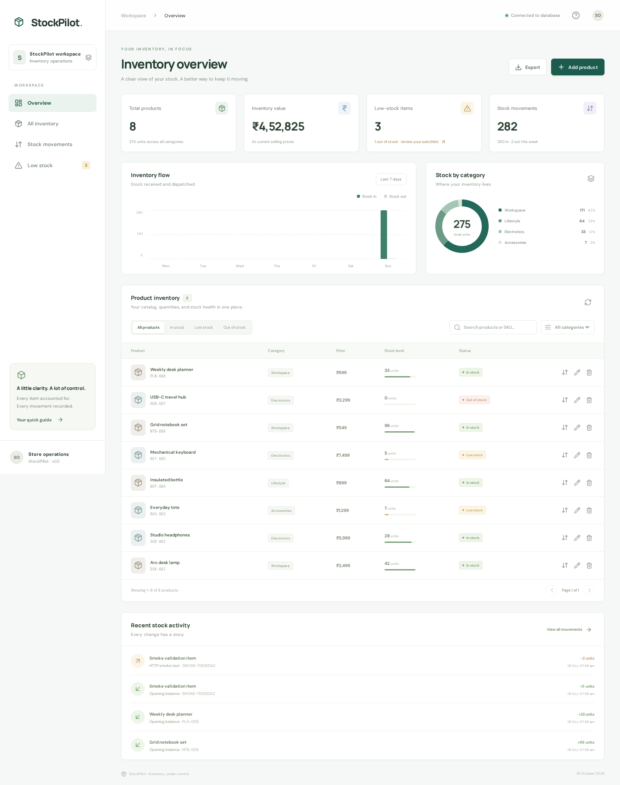
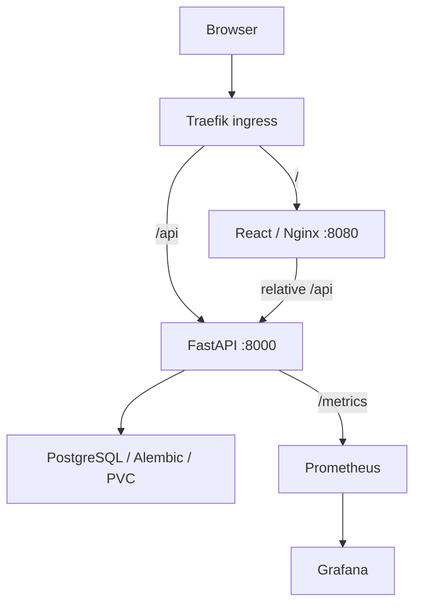
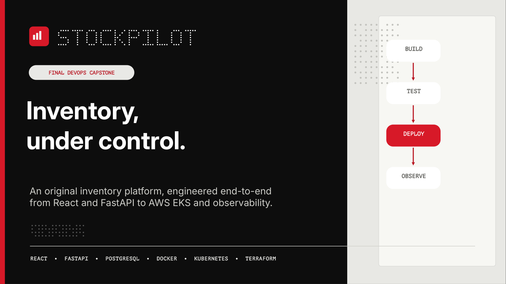

# StockPilot

**Inventory, under control.**

An inventory workspace for small businesses: manage products, adjust stock safely, and keep an auditable movement history. React and FastAPI share one PostgreSQL source of truth, supported by a tested container, delivery and observability stack.

[](https://github.com/not-so-shubh/devops-project/actions/workflows/ci-cd.yml)

[Presentation and demo](demo/README.md) · [Documentation](docs/README.md) · [Examiner handoff](docs/FINAL-PROJECT-HANDOFF.md) · [Evidence](docs/EVIDENCE.md) · [Rubric](docs/RUBRIC-CHECKLIST.md)



*Genuine historical EKS capture. The Sydney environment was deleted after approved cleanup on 22 October 2026. [Mobile capture](docs/evidence/eks-frontend-mobile.png) · [Capture provenance](docs/AWS-EKS-CAPTURE-REVIEW.md).*

## Quick access

| Evaluate | Open |
|---|---|
| Final PowerPoint | [Download editable slides](demo/StockPilot_Final_Presentation.pptx?raw=true) · [Preview](docs/presentation/StockPilot_Presentation_Preview.png) |
| Demo | [Download demo video](demo/StockPilot_Final_Demo.mp4?raw=true) · [Media details](demo/README.md) · [Timed presenter script](docs/FINAL-DEMO-SCRIPT.md) |
| CI/CD | [Workflow and current status](https://github.com/not-so-shubh/devops-project/actions/workflows/ci-cd.yml) · [Verified application baseline](https://github.com/not-so-shubh/devops-project/actions/runs/39696800574) |
| Container images | [Backend](https://github.com/users/not-so-shubh/packages/container/package/stockpilot-backend) · [Frontend](https://github.com/users/not-so-shubh/packages/container/package/stockpilot-frontend) · [Source-pinned receipts](docs/EVIDENCE.md#source-pinned-ci-evidence) |
| Grading | [All 46 criteria](docs/RUBRIC-CHECKLIST.md) · [Submission status](docs/SUBMISSION.md) |
| Run and inspect | [Deployment](docs/DEPLOYMENT.md) · [Testing](docs/TESTING.md) · [Troubleshooting](docs/TROUBLESHOOTING.md) |

## The product

Spreadsheets make stock changes difficult to reconcile. StockPilot gives each product a unique SKU and records every accepted quantity change with a reason and resulting balance.

- **Catalog:** create, inspect, edit, search, filter and delete products with prices, categories and reorder thresholds.
- **Stock control:** receive or remove units atomically. Concurrent removals cannot oversell available stock.
- **Retained history:** opening balances and movement snapshots survive catalog deletion.
- **Useful statistics:** product count, units, selling-price inventory value, low-stock alerts and seven-day stock flow come from the database.
- **Responsive workflow:** desktop/mobile navigation, accessible dialogs, loading/error/empty states and formula-safe CSV export.

Prices use INR. Inventory value means quantity × selling price, not accounting cost valuation. The low-stock KPI includes zero balances; the table separates positive low stock from out-of-stock items. Optional demo seed records are explicit database inserts, not hardcoded dashboard figures.

## Verified status

| Area | Evidence-backed result |
|---|---|
| Backend | 44 PostgreSQL tests passed; 97.67% coverage |
| Browser acceptance | Four desktop/mobile scenarios passed in Compose and through kind ingress |
| Security | Both images had zero HIGH/CRITICAL findings; frontend lockfile audit reported zero vulnerabilities across 124 dependencies |
| Delivery | SHA-tagged public GHCR images, Helm readiness, live monitoring and Flux revision-2 reconciliation passed |
| Real AWS | Sydney VPC/EKS, managed workers, manual Helm deployment and monitoring were verified historically |
| Cleanup | 33 Terraform resources destroyed; LB, three EBS disks, workers, VPC/NAT/EIP and project residual checks passed |

These application results are pinned to [source `8944da7`](https://github.com/not-so-shubh/devops-project/actions/runs/39696800574); later documentation commits have their own workflow runs. The [audit](docs/RUBRIC-CHECKLIST.md) covers **43 verified criteria / 94 technical points**. Another **4 points** require the student's security explanation and personal demonstration; **2 form points** are excluded from this task. Evidence coverage is not an awarded grade. Requested Console/terminal screenshot formats still depend on the genuine captures saved by the student.

**Current AWS state:** the reviewed EKS environment is deleted. Optional GitHub Actions EKS deployment remains disabled because organization policy blocked OIDC-provider access. Manual EKS deployment and automatic kind/Flux validation are separately identified.

## Tech stack

| Layer | Implementation |
|---|---|
| Frontend | React, Vite, CSS and Lucide |
| Backend | FastAPI, Pydantic, SQLAlchemy, Psycopg and Alembic |
| Database | PostgreSQL 17 with product and movement tables |
| Containers | Docker, Compose and unprivileged Nginx |
| Testing | Pytest/coverage, Playwright, Ruff and frontend utility tests/ESLint |
| Security | Trivy image/secret scans, Bandit and full frontend lockfile auditing |
| CI/CD | GitHub Actions and source-SHA images in GHCR |
| Infrastructure | Terraform, AWS VPC/EKS, managed nodes, IAM and EBS CSI |
| Orchestration | Kubernetes, Helm, Traefik and Flux |
| Observability | Prometheus, Grafana, metrics-server and HPA |

Dependencies use Python hash locks and npm lockfiles. Actions and base images are pinned to commits/digests. Exact installed versions belong to the source and its scan receipts.

## Architecture

Kubernetes request and metric paths:



| Environment | Delivery path | Current meaning |
|---|---|---|
| Local Compose | Nginx proxies `/api` to backend; PostgreSQL named volume | Available local workflow |
| CI kind | Scanned images, Helm, ingress, monitoring and Flux | Automatically created and deleted on the runner |
| Real AWS EKS | Approved Terraform provisioning and manual Helm bootstrap | Historical deployment, captured then destroyed |
| Optional AWS Actions job | OIDC authentication and namespace-scoped release update | Disabled by the account-policy blocker |

[Architecture decisions and data model](docs/ARCHITECTURE.md) · [Flux ownership](gitops/README.md).

## Quick start

Requirements: Git, Docker with Compose v2, Python 3 for local credential generation, and available loopback ports 3000/8000. Run from the repository root after cloning:

```bash
git clone https://github.com/not-so-shubh/devops-project.git
cd devops-project
umask 077
python3 - <<'PY'
from pathlib import Path
import secrets
p = Path('.env')
if not p.exists():
    p.write_text('POSTGRES_DB=stockpilot\nPOSTGRES_USER=stockpilot\n'
                 + 'POSTGRES_PASSWORD=' + secrets.token_urlsafe(32) + '\n')
    p.chmod(0o600)
    print('Created private local configuration.')
PY
docker compose config --quiet
docker compose up --build -d --wait --wait-timeout 180
docker compose exec backend python -m app.seed
docker compose ps
python3 scripts/smoke.py
```

Open [the app](http://localhost:3000), [Swagger](http://localhost:8000/docs), [readiness](http://localhost:8000/ready) or [metrics](http://localhost:8000/metrics). The seed is optional and idempotent. Existing `.env` credentials must match any existing database volume. PostgreSQL is private to the Compose network; application ports bind only to loopback.

```bash
docker compose logs -f backend
docker compose down
```

`down` retains the named database volume. [Deployment](docs/DEPLOYMENT.md#local-compose) explains persistence, configuration, local kind and cleanup choices.

## API

| Method | Route | Purpose |
|---|---|---|
| GET | `/health`, `/ready`, `/metrics` | Liveness, database/schema readiness and Prometheus exposition |
| GET / POST | `/api/products` | Search/filter/paginate or create a product with an opening balance |
| GET / PUT / DELETE | `/api/products/{id}` | Read, edit details or remove a catalog record |
| POST | `/api/inventory/adjustments` | Signed stock change plus reason, committed atomically |
| GET | `/api/inventory/movements` | Latest-first retained ledger and optional product filter |
| GET | `/api/inventory/stats` | Counts, inventory value, categories and seven-day flow |

Validation returns 422; absent products 404; duplicate SKUs or insufficient stock 409; database failures a sanitized 503. Quantity changes use the adjustment endpoint, not product-detail updates. [Backend contracts](backend/README.md).

## Delivery and proof

GitHub Actions runs PostgreSQL migrations/tests, frontend quality, Terraform mock validation and Helm checks. Compose then proves real HTTP, persistence and browser behavior. Both candidate images must pass blocking Trivy HIGH/CRITICAL scans before publication. The exact scanned image archives become source-SHA GHCR tags. Kind validates Kubernetes runtime and Flux reconciliation.

| Inspect | Source-pinned evidence |
|---|---|
| Tests and coverage | [44 PostgreSQL passes](https://github.com/not-so-shubh/devops-project/blob/fa40366375c8a05edbe6a0837071e988d496e62b/docs/evidence/pytest-postgres.txt) |
| Image scans | [Backend](https://github.com/not-so-shubh/devops-project/blob/fa40366375c8a05edbe6a0837071e988d496e62b/docs/evidence/trivy-backend.json) · [Frontend](https://github.com/not-so-shubh/devops-project/blob/fa40366375c8a05edbe6a0837071e988d496e62b/docs/evidence/trivy-frontend.json) |
| Frontend dependencies | [Full lockfile audit](https://github.com/not-so-shubh/devops-project/blob/fa40366375c8a05edbe6a0837071e988d496e62b/docs/evidence/frontend-sca.json) |
| Image provenance | [Backend receipt](https://github.com/not-so-shubh/devops-project/blob/fa40366375c8a05edbe6a0837071e988d496e62b/docs/evidence/ghcr-backend.json) · [Frontend receipt](https://github.com/not-so-shubh/devops-project/blob/fa40366375c8a05edbe6a0837071e988d496e62b/docs/evidence/ghcr-frontend.json) |
| GitOps update | [Flux fetched revision and Helm revision 2](https://github.com/not-so-shubh/devops-project/blob/fa40366375c8a05edbe6a0837071e988d496e62b/docs/evidence/gitops-ci.json) |

The [workflow](.github/workflows/ci-cd.yml) records later runs separately. [Security](security/README.md) explains real blocked CVEs and remediation. [Testing](docs/TESTING.md) distinguishes SQLite convenience checks from PostgreSQL concurrency evidence.

## Historical AWS and observability

Terraform provisioned Sydney (`ap-southeast-2`) networking with two public/two private subnets across two AZs, EKS 1.35, managed workers, storage/IAM and logging. The verified manual deployment had two Ready `m7i-flex.large` workers, two frontend/backend replicas and a Bound 5 GiB gp3 database. Prometheus saw two UP application targets; authenticated Grafana showed four populated panels. HPA CPU metrics came from metrics-server; scale-out was not claimed.

[Provisioning/runtime proof](docs/AWS-EKS-RUNTIME-VERIFICATION.md) · [Capture review](docs/AWS-EKS-CAPTURE-REVIEW.md) · [Approved cleanup](docs/AWS-CLEANUP-VERIFICATION.md) · [Monitoring guide](monitoring/README.md).

Cleanup completed at **05:16:28 IST on 22 October 2026**, beyond the original six-hour window. The executed command applied a saved `terraform plan -destroy` plan. The database backup was retained and checksum-verified. Actual billing totals/credits were not checked. No cloud operations are required to read or submit this repository.

## Presentation and demo

[](docs/presentation/README.md)

The supplied **16-slide editable PowerPoint** includes speaker notes and a dated verified project snapshot. [Download it](demo/StockPilot_Final_Presentation.pptx?raw=true), read the [presentation guide](docs/presentation/README.md), and rehearse the [timed script](docs/FINAL-DEMO-SCRIPT.md). A PowerPoint does not establish a completed personal demonstration. The supplied [demo MP4](demo/StockPilot_Final_Demo.mp4?raw=true) is now present alongside the deck in the root [`demo/` folder](demo/README.md). It runs 11:00.56 at 1920 × 1080 and has no audio track; personal explanation and instructor acceptance remain to be assessed. [The recording guide](docs/demo/README.md) contains the planned chapters.

## Project layout

| Path | Contents |
|---|---|
| [`backend/`](backend/README.md) | API, models, Alembic migrations and isolated tests |
| [`frontend/`](frontend/README.md) | Responsive React workspace and Nginx runtime |
| [`e2e/`](e2e/) | Desktop/mobile Playwright scenarios |
| [`docker/`](docker/README.md), [`docker-compose.yml`](docker-compose.yml) | Container guide and complete local stack |
| [`.github/workflows/`](.github/workflows/) | CI gates, publication and optional AWS job |
| [`terraform/`](terraform/README.md) | AWS network/cluster/storage/IAM lifecycle |
| [`k8s/`](k8s/), [`helm/stockpilot/`](helm/stockpilot/) | Bootstrap manifests and complete application chart |
| [`gitops/`](gitops/README.md), [`monitoring/`](monitoring/README.md) | Flux overlays and observability configuration |
| [`scripts/`](scripts/), [`troubleshooting/`](troubleshooting/) | Verification, traffic, bootstrap and isolated labs |
| [`demo/`](demo/README.md) | Required submission media: editable deck and supplied MP4 present; video has no audio track |
| [`docs/`](docs/README.md) | Guides, genuine evidence, presentation notes and recording preparation |
| [`application/`](application/README.md), [`kubernetes/`](kubernetes/README.md) | Coursework deliverable mappings to canonical sources |

## Documentation

Start with the [documentation hub](docs/README.md) or [final examiner handoff](docs/FINAL-PROJECT-HANDOFF.md). The hub indexes architecture, development, containers, CI/CD, security, Terraform, Kubernetes/GitOps, monitoring, troubleshooting, evidence and grading within two clicks of this page.

This is a single-workspace capstone with a single database and NAT gateway. Business use would require application authentication/authorization, TLS, availability planning, durable monitoring and tested backup recovery. [Decisions and limits](docs/ARCHITECTURE.md#operational-tradeoffs).

## Attribution and license

StockPilot's inventory application, schema, workflows and visual design are original. The DevOps architecture and evaluation requirements follow [Nency-Ravaliya/devops-heros, session 21](https://github.com/Nency-Ravaliya/devops-heros/tree/main/session21-python). [Originality notice](NOTICE.md) · [Project MIT license](LICENSE) · [Retained reference license](LICENSE.reference).

Official form submission: **Student action — excluded from this task**. See [the final checklist](docs/SUBMISSION.md).
