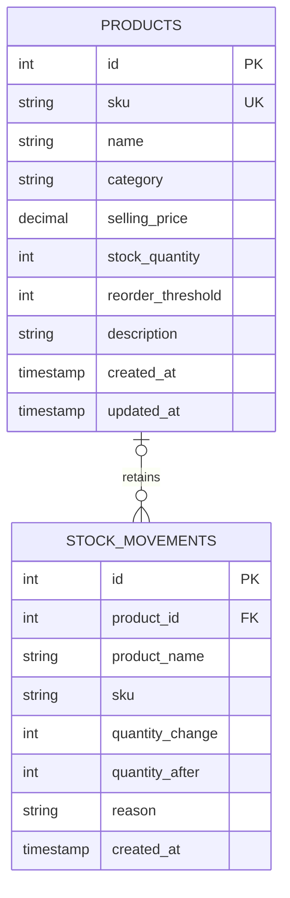
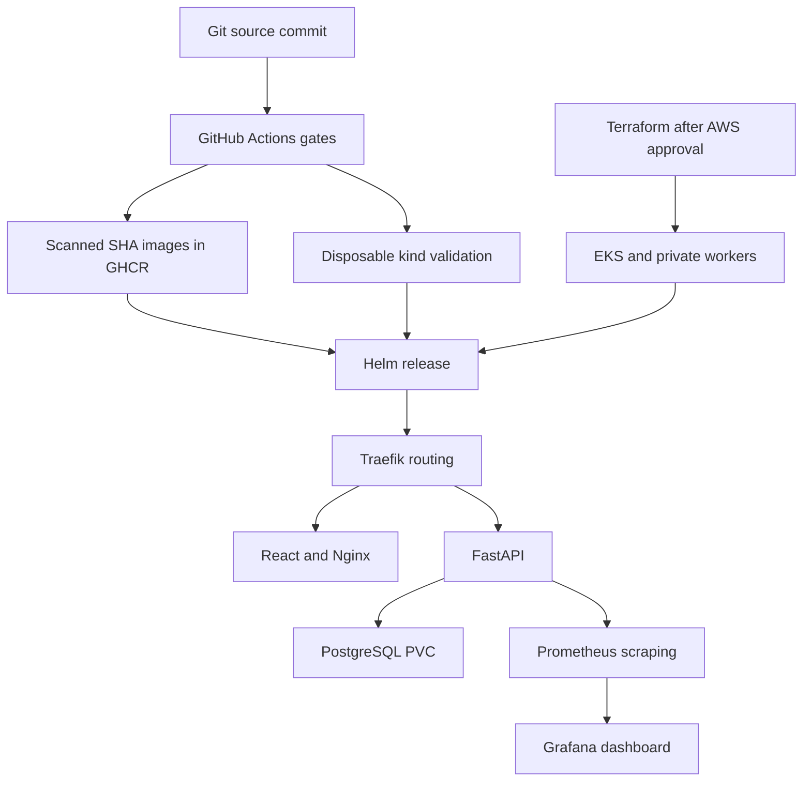

# Architecture and decisions

StockPilot is a single-workspace inventory platform. The browser reads all displayed data from the API. Database-backed seed examples are optional. Inventory, stock history, and aggregate statistics share one relational source of truth.

The nullable foreign key uses `ON DELETE SET NULL`. Movement snapshots keep their original SKU/name after edits or deletion. Quantities are integers; prices use `NUMERIC(12,2)` and Decimal validation, not floating-point storage. Responses normalize timestamps to UTC, including local SQLite tests.

An adjustment executes `UPDATE products SET stock_quantity = stock_quantity + delta WHERE id = ... AND stock_quantity + delta BETWEEN 0 AND 1000000 RETURNING ...`, then inserts the movement and commits. PostgreSQL serializes competing writes to the row and reevaluates the condition. An insufficient balance returns 409 without a movement. A failure before commit rolls back both operations. Product creation similarly commits its opening balance with the product.

The API imports models but never creates tables on startup. Alembic is the production schema owner. Readiness runs a real query and checks the products table; liveness stays independent of a database outage. The migration service/Job is the sole migration runner for a deployment. Release migrations must be backward compatible during rolling updates. Database recovery requires tested backups; Helm rollback alone is insufficient.

The frontend keeps URLs relative, avoiding build-time cluster hostnames. Nginx uses 8080 as UID 101 and proxies `/api/` unchanged to Service `backend:8000`; Ingress handles `/api` directly, then `/` to frontend. The chart intentionally supports one StockPilot release per namespace because these Service DNS names are stable. Use separate namespaces for dev/prod or additional instances.

Kubernetes runs two frontend replicas and a backend HPA with minimum two and maximum six at 65% of the 100m CPU request. Limits protect the node; requests make scheduling and CPU utilization meaningful. Metrics-server supplies resource metrics for HPA. Prometheus is a separate metrics system for observation, not the HPA CPU data provider.

The demonstration PostgreSQL StatefulSet has a PVC. EKS uses encrypted gp3 via the EBS CSI driver, with Pod Identity granting only the CSI role EBS permissions. The CSI role, EKS roles and access entries are defined in Terraform. CNI permissions are attached to the demo node role; a production hardening step is a dedicated CNI Pod Identity/IRSA role. Single NAT and a single DB are documented availability tradeoffs.

HTTP counters and latency histograms use route-template labels, including status codes, and exclude `/metrics` requests. The Grafana dashboard aggregates all backend replicas. ServiceMonitor selection is explicit on namespace, release label and Service labels/port. Its namespace label must exist before monitoring installation.

The CI path is reproducible and gated: quality → Compose → build/scan → publish and kind integration → optional EKS. Candidate image tar archives ensure the pushed bytes are the scanned bytes. AWS OIDC trusts the exact repository's `production` environment. IAM permits describing only the intended EKS cluster; EKS access grants edit only in `stockpilot`, while a human operator bootstraps namespace, storage, monitoring and secrets.

## Delivery architecture for the presentation

This diagram describes the intended paths. The kind branch has actual executed evidence; the AWS Terraform/EKS branch remains unexecuted until authentication and approval. Production Actions ownership and Flux reconciliation are alternatives for a release; the CI exercise hands ownership to Flux in its disposable cluster.

## Tool responsibilities

| Tool | Purpose in StockPilot |
|---|---|
| Git / GitHub | Source history, reviewable changes and repository hosting. |
| React / Vite | Browser interactions and a reproducible static frontend build. |
| FastAPI / Pydantic | REST routing, input validation and API documentation. |
| SQLAlchemy / Psycopg | Transactional database access and PostgreSQL connectivity. |
| PostgreSQL / Alembic | Durable inventory/ledger records and versioned schema migrations. |
| Pytest / coverage | API/database behavior checks and measurement of exercised Python statements. |
| Ruff / ESLint | Python/JavaScript static quality checks and consistent Python formatting. |
| Playwright | Real desktop/mobile browser acceptance and screenshots. |
| Docker / Compose | Reproducible images and the local application/database stack. |
| Nginx | Non-root static frontend serving and local API proxy. |
| GitHub Actions | Ordered quality, infrastructure, Compose, build, scan, publish and cluster checks. |
| Bandit / Trivy / npm audit | Python security analysis, secret detection, image OS/library scans and a separate frontend lockfile vulnerability gate. |
| GHCR | Published backend/frontend images identified by tested source SHA. |
| Terraform / AWS provider | Declarative AWS network, EKS, workers, IAM, storage driver and logging lifecycle. |
| AWS IAM / OIDC | Scoped identities/access; short-lived GitHub deployment credentials. |
| EKS / EC2 managed nodes | Proposed AWS control plane and worker compute; not yet provisioned here. |
| kind | Actual disposable Kubernetes environment used in CI without paid AWS infrastructure. |
| kubectl | Apply/inspect Kubernetes objects, rollout state, metrics and debugging information. |
| Helm | Versioned app/controller/monitoring packages and release upgrades. |
| Traefik | Ingress controller routing `/` to frontend and `/api` to backend. |
| EBS CSI / Pod Identity | Proposed EKS gp3 volume provisioning with a separate AWS storage role. |
| metrics-server / HPA | Resource CPU metrics and backend replica adjustment. |
| Prometheus Operator / ServiceMonitor | Monitoring resource management and application scrape discovery. |
| Prometheus / Grafana | Metrics collection/querying and dashboards with real request/latency data. |
| Flux | Git source retrieval and Helm desired-state reconciliation, verified in CI. |

See [FINAL-DEMO-SCRIPT.md](FINAL-DEMO-SCRIPT.md) for the timed walkthrough and [INSTRUCTOR-QA.md](INSTRUCTOR-QA.md) for tradeoffs and remaining limits.
