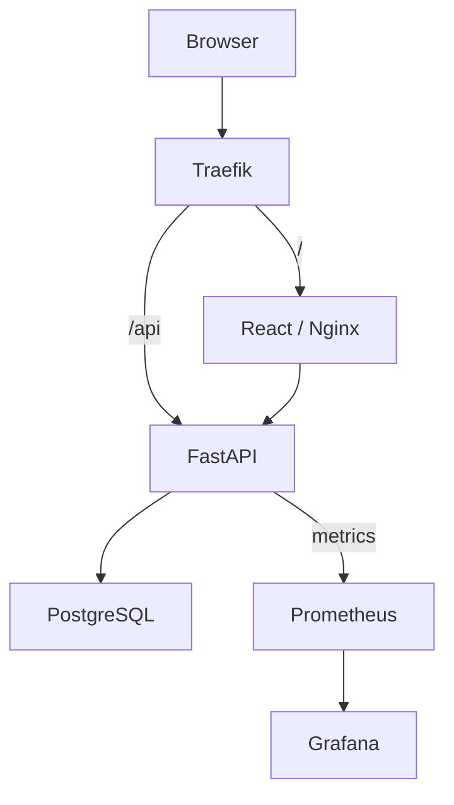
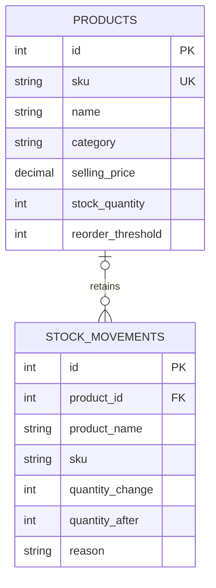
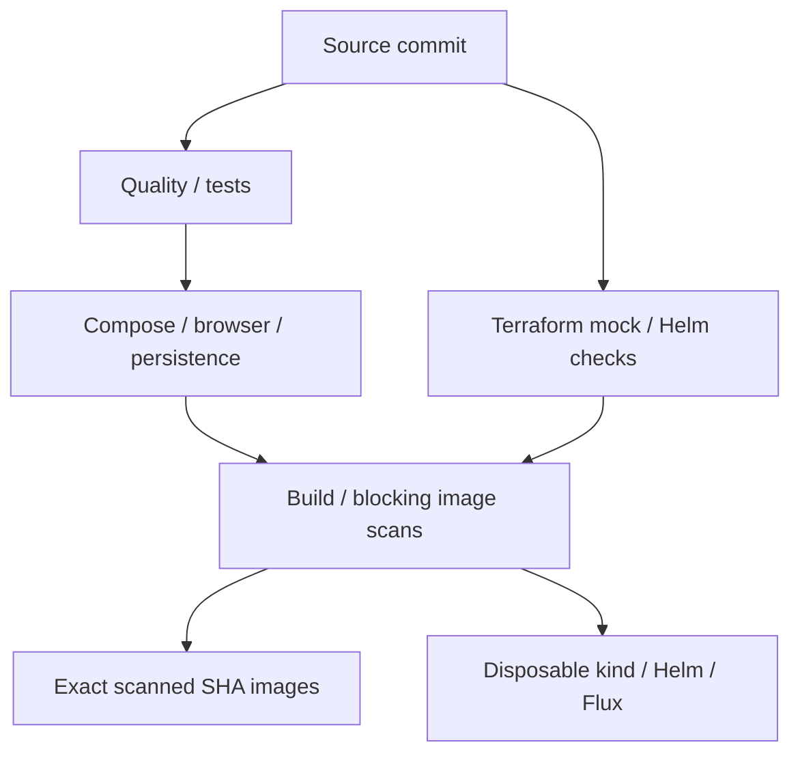

# Architecture and decisions

[Documentation hub](README.md) · [Run the system](DEPLOYMENT.md) · [Evidence](EVIDENCE.md)

StockPilot is a single-workspace inventory application. Products, stock movements and dashboard statistics share one relational source of truth. Optional seed records are inserted explicitly, never on application startup.

## Request paths

| Environment | Request route |
|---|---|
| Compose | Browser `localhost:3000` → unprivileged Nginx `:8080` → unchanged `/api` proxy to `backend:8000` |
| Kubernetes | Traefik sends `/` to frontend `:8080` and `/api` directly to backend `:8000`; frontend also supports relative API proxying |

The frontend does not embed a cluster hostname. Stable Service names support one StockPilot Helm release per namespace; use separate namespaces for separate releases.

## Data and stock correctness

The movement's nullable foreign key uses `ON DELETE SET NULL`. SKU/name snapshots preserve history after product edits or deletion. Prices use `NUMERIC(12,2)` and Decimal validation; quantities are integers bounded from zero to 1,000,000. Responses normalize timestamps to UTC.

An adjustment conditionally updates the row only when `stock_quantity + delta` is within bounds, obtains the resulting balance, inserts the movement and commits once. PostgreSQL serializes competing row writes and reevaluates the condition. Insufficient balance returns 409 without a false ledger event; a failed transaction rolls back both changes. The [PostgreSQL concurrency test](https://github.com/not-so-shubh/devops-project/blob/fa40366375c8a05edbe6a0837071e988d496e62b/docs/evidence/pytest-postgres.txt) verifies simultaneous removals.

Alembic owns deployed schema changes. Compose runs a one-shot migration service; Helm runs a revisioned migration Job. Backend readiness checks the database and migrated products table, while liveness is independent of database availability. Helm rollback cannot restore database state or reverse migrations safely by itself.

## Delivery environments

Images are exported after scanning and those exact archives are published to GHCR. Pull requests validate a reachable PR head SHA without publishing; main pushes validate the resulting main SHA. Flux fetches that same commit in its disposable CI overlay. [GitOps details](../gitops/README.md).

The real Sydney EKS environment followed a separately approved Terraform and **manual Helm** path, verified on 18 October and destroyed after separate approval on 22 October. The optional Actions EKS job stayed disabled because AWS organization policy blocked OIDC-provider access. [Runtime record](AWS-EKS-RUNTIME-VERIFICATION.md) · [Cleanup](AWS-CLEANUP-VERIFICATION.md).

## Kubernetes and metrics

The production-values demo uses two frontend/backend replicas. Backend HPA has minimum two, maximum six, and a 65% CPU target against its CPU request. Metrics-server supplies HPA resource metrics. Prometheus independently scrapes HTTP counters and latency histograms; route-template labels avoid unbounded product-ID cardinality. Grafana aggregates backend replicas. The observed low-load EKS HPA stayed at two; metrics availability is not evidence of scale-out.

EKS gp3 storage used encryption and EBS CSI with a dedicated Pod Identity role. ServiceMonitor discovery matches the application namespace, `release=monitoring`, backend Service labels and named `http` port. [Monitoring configuration and queries](../monitoring/README.md).

## Security boundaries

- Backend UID 10001 and frontend UID 101, read-only filesystems, writable temporary mounts, dropped capabilities and no privilege escalation.
- Locked Python/npm dependencies, pinned Actions/base images, Bandit, secret scanning, separate lockfile SCA and blocking image vulnerability scans.
- Kubernetes Secret references instead of committed credentials; restricted EKS operator `/32` plus private API access.
- Optional CI role design permits cluster description and namespace-scoped edits, not infrastructure bootstrap. It was not enabled in the policy-restricted account.

## Operational tradeoffs

| Decision | Consequence |
|---|---|
| Single PostgreSQL replica/PVC | Persistence for the capstone, without database HA or a proven full restore rehearsal |
| Single NAT gateway | Smaller demo footprint, with an AZ dependency and possible cross-AZ traffic |
| CNI policy on node role | Dedicated CNI Pod Identity/IRSA would narrow permissions further |
| One Uvicorn worker per container | Clear per-process metrics; capacity scales through replicas |
| Ephemeral monitoring storage | Good for a demo; business retention/backups need separate design |
| No application login/RBAC | Use synthetic data; business operation needs authentication and authorization |
| HTTP EKS demo ingress | A real certificate and TLS configuration remain production work |
| Scoped cleanup audit | Confirms reviewed project resources; it does not certify account-wide billing or credits |

[Security controls](../security/README.md) · [Instructor questions](INSTRUCTOR-QA.md) · [Tool/application source guide](../application/README.md).
