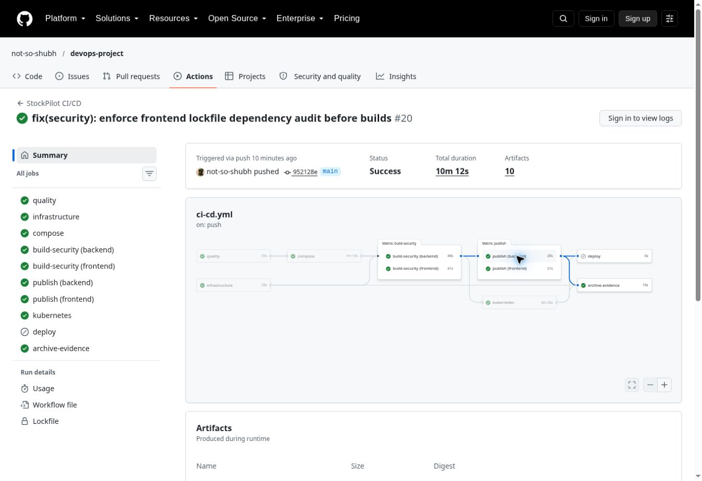

# Final verified project handoff

Reviewed source `952128e01e9afed9a0349faf7c7b58d04e5a96b5`; [successful workflow](https://github.com/not-so-shubh/devops-project/actions/runs/39071726194).

This report was independently prepared after reading the actual source-specific CI archive. The original `ci-run.json` and automated reports are unchanged. Supplementary browser captures and this review have separate provenance.

| Deliverable | Actual result |
|---|---|
| 1. Repository | [Main repository](https://github.com/not-so-shubh/devops-project) |
| 2. Latest tested main source | `952128e01e9afed9a0349faf7c7b58d04e5a96b5` |
| 3. Successful Actions run | [Full green run](https://github.com/not-so-shubh/devops-project/actions/runs/39071726194); all enabled jobs succeeded; AWS deployment skipped. |
| 4. AWS identity / region | Account identity unavailable; intended region ap-south-1. No AWS credentials or paid-resource authorization available. |
| 5. Terraform plan | Real account-backed plan BLOCKED. Actual CI fmt/init/validate and mocked topology check passed; local startup failures preserved separately. |
| 6. VPC / public subnets | BLOCKED; no real AWS resources created or console screenshots claimed. |
| 7. EKS / workers | BLOCKED; kind is not EKS and does not satisfy AWS provisioning. |
| 8. Helm | Actual kind Helm release revision 1; Flux reconciled a successful revision-2 upgrade. |
| 9. Running application | CI verified API CRUD and desktop/mobile browser interactions. Final Running/Ready Pods: {'backend': 2, 'frontend': 2, 'postgres': 1}. Disposable cluster was deleted afterward. |
| 10. Ingress | Actual Traefik / and /api routing, browser checks through controller port-forward; no public EKS/LB endpoint exists. |
| 11. HPA | CPU metrics available and ScalingActive asserted by CI; scale-out is not claimed without observation. |
| 12. Monitoring | Two application targets UP, positive request rate 1.8748557407407407/second and genuine populated Grafana screenshot; environment is kind. |
| 13. Trivy explanation | [TRIVY-EXPLANATION.md](TRIVY-EXPLANATION.md); libexpat 2.9.0-r0; zero HIGH/CRITICAL in both reports; npm SCA graph separately audited. |
| 14. Commit-to-deployment | This real source commit passed CI, image scans/publication, Helm rollout and exact-SHA Flux reconciliation. Student live/accepted recorded presentation remains READY FOR DEMO. |
| 15. Presentation materials | [Timed script](FINAL-DEMO-SCRIPT.md), [capture checklist](FINAL-PRESENTATION-CHECKLIST.md), [instructor Q&A](INSTRUCTOR-QA.md), [architecture/tools](ARCHITECTURE.md). |
| 16. Terraform destroy | BLOCKED; no real AWS apply/destroy executed. Actual CI kind cleanup succeeded; that is not AWS cleanup proof. |
| 17. Remaining work | 11 AWS points need authenticated execution and explicit cost/plan/cleanup approvals; 4 points need student explanation/presentation; 2 form points are excluded. Preserve required literal terminal/console capture formats. |
| 18. Final grading audit | [All 46 criteria](FINAL-RUBRIC-AUDIT.md), [machine-readable audit](final-rubric-audit.json): 83 VERIFIED / 4 READY FOR DEMO / 11 BLOCKED / 2 EXCLUDED. Instructor awards grades. |

## Original proof

- [ci-run.json](https://github.com/not-so-shubh/devops-project/blob/36f198a7082645add272a32548d3b4fd6d172ae2/docs/evidence/ci-run.json)
- [pytest-postgres.txt](https://github.com/not-so-shubh/devops-project/blob/36f198a7082645add272a32548d3b4fd6d172ae2/docs/evidence/pytest-postgres.txt)
- [trivy-backend.json](https://github.com/not-so-shubh/devops-project/blob/36f198a7082645add272a32548d3b4fd6d172ae2/docs/evidence/trivy-backend.json)
- [trivy-frontend.json](https://github.com/not-so-shubh/devops-project/blob/36f198a7082645add272a32548d3b4fd6d172ae2/docs/evidence/trivy-frontend.json)
- [frontend-sca.json](https://github.com/not-so-shubh/devops-project/blob/36f198a7082645add272a32548d3b4fd6d172ae2/docs/evidence/frontend-sca.json)
- [ghcr-backend.json](https://github.com/not-so-shubh/devops-project/blob/36f198a7082645add272a32548d3b4fd6d172ae2/docs/evidence/ghcr-backend.json)
- [ghcr-frontend.json](https://github.com/not-so-shubh/devops-project/blob/36f198a7082645add272a32548d3b4fd6d172ae2/docs/evidence/ghcr-frontend.json)
- [kubernetes-ci.txt](https://github.com/not-so-shubh/devops-project/blob/36f198a7082645add272a32548d3b4fd6d172ae2/docs/evidence/kubernetes-ci.txt)
- [cluster-health-ci.json](https://github.com/not-so-shubh/devops-project/blob/36f198a7082645add272a32548d3b4fd6d172ae2/docs/evidence/cluster-health-ci.json)
- [helm-release-ci.txt](https://github.com/not-so-shubh/devops-project/blob/36f198a7082645add272a32548d3b4fd6d172ae2/docs/evidence/helm-release-ci.txt)
- [hpa-metrics-ci.txt](https://github.com/not-so-shubh/devops-project/blob/36f198a7082645add272a32548d3b4fd6d172ae2/docs/evidence/hpa-metrics-ci.txt)
- [prometheus-targets.png](https://github.com/not-so-shubh/devops-project/blob/36f198a7082645add272a32548d3b4fd6d172ae2/docs/evidence/prometheus-targets.png)
- [grafana-dashboard.png](https://github.com/not-so-shubh/devops-project/blob/36f198a7082645add272a32548d3b4fd6d172ae2/docs/evidence/grafana-dashboard.png)
- [troubleshooting-investigation-ci.txt](https://github.com/not-so-shubh/devops-project/blob/36f198a7082645add272a32548d3b4fd6d172ae2/docs/evidence/troubleshooting-investigation-ci.txt)
- [gitops-ci.json](https://github.com/not-so-shubh/devops-project/blob/36f198a7082645add272a32548d3b4fd6d172ae2/docs/evidence/gitops-ci.json)

## Cloud authorization boundary

[AWS-READINESS.md](AWS-READINESS.md) contains current public Mumbai prices, the proposed $10/six-hour envelope and secure connection checklist. The proposal is not approved, and it is not a hard spending cap. A real account-specific nonempty plan and explicit paid-resource approval are required before apply. Save all cloud/demo evidence before separately approved teardown.

**Official form: Student action — excluded from this task. No form was opened, populated or submitted.**

## Genuine browser captures

[Earlier blocked frontend scan](evidence/ci-blocked-libexpat-bd40732.jpg) · [Earlier pipeline running](evidence/ci-in-progress-bd40732.jpg) · [Exact capture provenance](evidence/final-browser-captures.json). These captures show real pipeline states, not an accepted student recording or an AWS console.

The genuine Grafana capture retains transient error and latency history; it was not edited to hide it. The later readiness, API/browser and Flux smoke checks passed. The cluster was deleted at the end of CI, so the screenshots are historical execution evidence rather than a currently live service.
